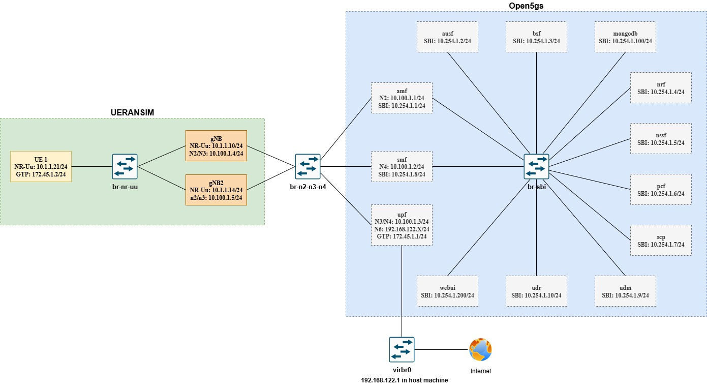

# 5G Standalone with Open5GS and UERANSIM

This scenario uses Containerlab and Open vSwitch to connect an Open5GS core to UERANSIM gNB and UE nodes. This guide covers configuration, deployment, copying source into containers, building, and starting the nodes. The [UERANSIM README](UERANSIM/README.md) explains the simulator's protocol layers, mobility model, Wi-Fi modes, and handover behavior.

Roaming is currently unsupported.

## Scenario topology



The topology files are [open5gs-5gc.yaml](topologies/open5gs-5gc.yaml) and [ueransim.yaml](topologies/ueransim.yaml). The supplied RAN topology defines `gnb`, `nr_gnb`, `ue1`, and `ue2`; adapt the commands below when changing those nodes.

## Prerequisites

- A Linux host with Docker, Containerlab, and Open vSwitch installed.
- Administrative access for container and network operations.
- All container images referenced by the topology files available to Docker.
- A complete merged `UERANSIM/` source directory containing `CMakeLists.txt` and `makefile`.
- The [UERANSIM build dependencies](UERANSIM/README.md#build-and-configuration-references) installed inside each container where the source will be built.

Run the host commands below from the `5g_sa_open5gs_ueransim` directory containing this README. Commands that invoke scripts use a subshell to preserve that working directory.

## Configure the scenario

Edit the Open5GS files in [conf/open5gs/](conf/open5gs/) and the RAN files in [conf/ueransim/](conf/ueransim/) before deployment. Keep IP addresses and interface names consistent with the topology. Cellular UE identities, authentication values, PLMN, DNN, and slice settings must agree with the core configuration. If subscriber identities or authentication values change, update the provisioning commands in [scripts/deploy.sh](scripts/deploy.sh) as well.

| Node | Configuration on the host | Container | Configuration in the container |
| --- | --- | --- | --- |
| Main gNB | [conf/ueransim/gnb.yaml](conf/ueransim/gnb.yaml) | `clab-ueransim-gnb` | `/gnb.yaml` |
| Second gNB | [conf/ueransim/nr_gnb.yaml](conf/ueransim/nr_gnb.yaml) | `clab-ueransim-nr_gnb` | `/nr_gnb.yaml` |
| UE 1 | [conf/ueransim/ue1.yaml](conf/ueransim/ue1.yaml) | `clab-ueransim-ue1` | `/ue1.yaml` |
| UE 2 | [conf/ueransim/ue2.yaml](conf/ueransim/ue2.yaml) | `clab-ueransim-ue2` | `/ue2.yaml` |

For supported YAML fields and examples, use the [gNB/AP reference](UERANSIM/docs/GNB_CONFIGURATION.md) and [UE reference](UERANSIM/docs/UE_CONFIGURATION.md). The UE's `gnbSearchList` contains the reachable `linkIp` addresses of its candidate gNBs or APs. Movement is configured through `phyLocation`, `velocity`, and `pattern`.

## Deploy the scenario

Run on the host:

```bash
(cd scripts && bash deploy.sh)
```

The script creates the Open vSwitch bridges, deploys both Containerlab topologies, starts the core services, provisions the sample subscribers, and copies the main gNB and UE configuration files. Use the following steps to prepare and run the merged UERANSIM source.

## Manual startup inside containers

### 1. Copy the UERANSIM source

Use a source directory without generated `build/` or `build.stale*` directories. Each container will create its own build. On the host, copy the contents of `UERANSIM/` into `/UERANSIM/` in each RAN container:

```bash
for container in clab-ueransim-gnb clab-ueransim-nr_gnb clab-ueransim-ue1 clab-ueransim-ue2; do
  sudo docker exec "$container" mkdir -p /UERANSIM
  sudo docker cp UERANSIM/. "${container}:/UERANSIM/"
done
```

### 2. Copy the node configuration files

Run on the host. These commands also include the second gNB configuration, which `deploy.sh` does not copy:

```bash
sudo docker cp conf/ueransim/gnb.yaml clab-ueransim-gnb:/gnb.yaml
sudo docker cp conf/ueransim/nr_gnb.yaml clab-ueransim-nr_gnb:/nr_gnb.yaml
sudo docker cp conf/ueransim/ue1.yaml clab-ueransim-ue1:/ue1.yaml
sudo docker cp conf/ueransim/ue2.yaml clab-ueransim-ue2:/ue2.yaml
```

Repeat the relevant copy command after changing a configuration file on the host.

### 3. Build inside each container

Open a shell from the host, using the container name from the configuration table. For example:

```bash
sudo docker exec -it clab-ueransim-gnb bash
```

Inside that container, run:

```bash
cd /UERANSIM
make
```

Repeat this build step in every container that will run UERANSIM. `make` creates `build/` and builds both `nr-gnb` and `nr-ue` from the same source tree.

### 4. Validate and start each node

Inside the appropriate container, run the command for that node. Each command sets `/UERANSIM` as its working directory:

| Node | Startup command |
| --- | --- |
| Main gNB | `bash -c 'cd /UERANSIM && ./build/nr-gnb -c /gnb.yaml'` |
| Second gNB | `bash -c 'cd /UERANSIM && ./build/nr-gnb -c /nr_gnb.yaml'` |
| UE 1 | `bash -c 'cd /UERANSIM && ./build/nr-ue -c /ue1.yaml'` |
| UE 2 | `bash -c 'cd /UERANSIM && ./build/nr-ue -c /ue2.yaml'` |

Add `--check-config` inside the quoted command to validate the YAML before starting a node. For example, inside the main gNB container:

```bash
bash -c 'cd /UERANSIM && ./build/nr-gnb -c /gnb.yaml --check-config'
bash -c 'cd /UERANSIM && ./build/nr-gnb -c /gnb.yaml'
```

Start the gNB or AP processes before the UE processes. Keep each process in its own terminal so its logs remain visible. Press `Ctrl+C` in that terminal to stop it.

## Start UERANSIM using the provided scripts

The helper scripts invoke binaries at `/gNB_UERANSIM/build/` in the supplied container images. Use this option when running those image binaries; the manual startup commands above run the merged source built under `/UERANSIM`.

Run each command on the host in a separate terminal:

```bash
(cd scripts && bash start-gnb.sh)
```

```bash
(cd scripts && bash start-ue1.sh)
```

```bash
(cd scripts && bash start-ue2.sh)
```

## SSH access

After deployment starts the SSH services, the UE containers can also be accessed from the host with:

```bash
ssh root@clab-ueransim-ue1
```

```bash
ssh root@clab-ueransim-ue2
```

The default password for the supplied UE images is `gprsumts`. For direct container access, use `sudo docker exec -it clab-ueransim-ue1 bash` or the corresponding container name.

## Remove the scenario

Run on the host to destroy both topologies and remove the bridges created by the deployment script:

```bash
(cd scripts && bash destroy.sh)
```
