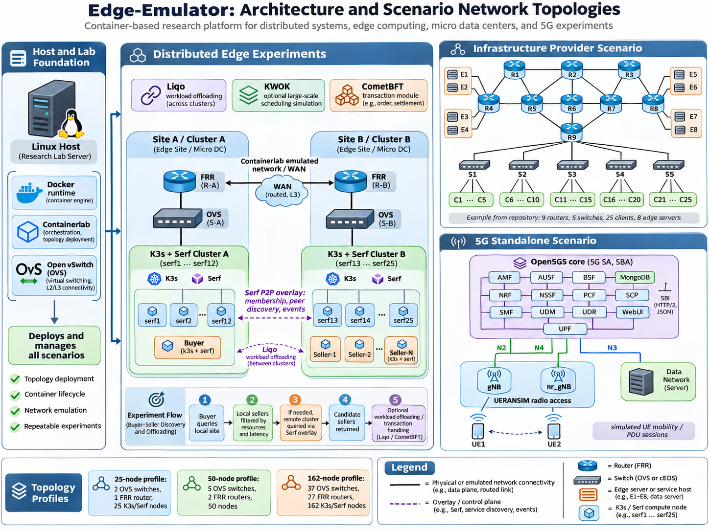

# Edge-Emulator

**A container-based lab for distributed systems, edge computing, and micro data centers.**

Edge-Emulator is a research platform for studying distributed systems and edge infrastructures. It provides container topologies, configurations, and experiment scripts for connecting users, networks, and compute services across multiple sites in a controllable lab.

Built on [Containerlab](https://containerlab.dev/), the platform combines network emulation, Kubernetes clusters, decentralized P2P overlays, and workload simulation. Containerlab manages lab nodes and their connections; Edge-Emulator provides scenarios for exploring how distributed services discover peers, coordinate resources, and deploy workloads across sites.

[Why containers](#why-containers-for-edge-computing) · [Scenarios](#scenarios) · [Get started](#get-started) · [Contribute](#contributing)

## Why containers for edge computing?

Distributed applications span edge nodes, micro data centers, and Kubernetes clusters. Their behavior depends on the resources at each site and the links between them. Evaluating service coordination, placement, latency, and resource sharing requires a lab where those conditions can be changed and the setup recreated.

[Containers](https://docs.docker.com/get-started/docker-overview/) package software in lightweight, isolated environments. Combined with Containerlab's topology definitions, they provide a practical foundation for edge experiments:

- **Run real software:** Combine network operating systems, Kubernetes services, and application code in the same lab.
- **Model multiple sites:** Represent micro data centers with compute nodes or clusters and study how services cooperate across them.
- **Reuse environments:** Share container images, topology files, and configurations across experiments.
- **Control the network:** Define links, routes, and scenario-specific delay settings alongside compute nodes.
- **Repeat the workflow:** Deploy a topology, run an experiment, inspect its behavior, and rebuild it for the next test.

## How the platform fits together


The diagram provides an overview of the Edge-Emulator architecture and its supported network scenarios. Dashed arrows represent logical overlays for peer-to-peer communication and workload offloading between edge clusters. These communications take place over the emulated network infrastructure.

Depending on the experiment, the platform uses different tools for container orchestration, network emulation, resource discovery, and workload management:

| Component | Role |
| --- | --- |
| Containerlab and Docker | Create containers, connect nodes, and manage the lab lifecycle. |
| K3s | Run Kubernetes services at edge sites and micro data centers. |
| [Serf](https://github.com/hashicorp/serf) | Provide decentralized membership, peer discovery, and event exchange. |
| [KWOK](https://kwok.sigs.k8s.io/) | Simulate Kubernetes node and pod lifecycles for scheduling and scale experiments. |
| [Liqo](https://docs.liqo.io/) | Peer Kubernetes clusters and support workload offloading between sites. |

Router and switch options follow Containerlab's [supported node kinds](https://containerlab.dev/manual/kinds/). Choose the appropriate node kind and image, then adapt the topology's interfaces and device configurations.

## Implementation Languages


Edge-Emulator integrates several implementation languages:

- **Go:** Peer-to-peer integration and transaction components.
- **C++:** UERANSIM-based 5G network simulation.
- **Python:** Experiment automation, resource discovery,
  and service integration.


## Scenarios

| Area | What you can explore | Guide |
| --- | --- | --- |
| Edge network infrastructure | Networks using router and switch types supported by Containerlab, connected to Linux clients and edge servers. | [Infrastructure example](examples/Edge_infrastructure_provider/README.md) |
| Micro data centers and edge clusters | Model interconnected compute sites with K3s environments and configurable network layouts. | [25-node](examples/Transaction_platform_implemetation-main/25_nodes_unclustered/25nodeTopo/README.md) · [50-node](examples/Transaction_platform_implemetation-main/50_nodes_unclustered/50-Node-Topology/README.md) · [162-node](examples/Transaction_platform_implemetation-main/162_nodes_unclustered/162-Node-Topology/README.md) |
| Distributed systems and resource sharing | Serf P2P overlays, service coordination, resource selection, Liqo workload offloading, and transaction workflows. | [Distributed edge experiments](examples/Transaction_platform_implemetation-main/README.md) |
| External Wi-Fi access | Connecting a physical access point and client devices to an emulated network. | [AP integration](examples/frr_AP/README.md) |
| Standalone 5G simulation and UE mobility | Simulate a standalone 5G network using the Open5GS core and UERANSIM gNBs and UEs, including UE registration, PDU sessions, mobility, and simulated inter-gNB handover. | [Standalone 5G scenario](5g_sa_open5gs_ueransim/README.md) |

## Get started

### 1. Prepare the host

Use a Linux host with Git, administrative access, and sufficient CPU, memory, and storage for the selected scenario. Larger Kubernetes examples require substantially more resources than basic network labs. Container images must support the host's architecture.

Clone the repository:

```bash
git clone https://github.com/Edge-Emulator/Edge-Emulator.git
cd Edge-Emulator
```

### 2. Install the base tools

On Ubuntu, run the supplied bootstrap script:

```bash
bash start.sh
```

The script configures Docker, Containerlab, and Wireshark, and prepares example network and edge-node images. Select compatible router and switch images, and install Open vSwitch or additional tools as required by your chosen scenario.

For manual installation or other Linux environments, follow the official [Docker installation guide](https://docs.docker.com/engine/install/) and [Containerlab installation guide](https://containerlab.dev/install/).

Verify the base tools:

```bash
sudo docker version
sudo containerlab version
```

### 3. Choose an experiment

Open a guide in the [scenario table](#scenarios), review its requirements, and adjust its image names, addresses, and interfaces before deployment. Use the scenario's scripts to configure its network and services, then run the workload or connectivity checks described in that guide.

For mobile access experiments, start with the [5G scenario guide](5g_sa_open5gs_ueransim/README.md). It covers copying UERANSIM source and YAML files into containers, building, and starting each node.

## Contributing

Contributions to scenarios, automation, documentation, and experiment workflows are welcome. Use [issues](https://github.com/Edge-Emulator/Edge-Emulator/issues) to report problems or discuss ideas, and [pull requests](https://github.com/Edge-Emulator/Edge-Emulator/pulls) to propose changes. Include the scenario, software versions, reproduction steps, and relevant logs when reporting a problem.

## Acknowledgements

Edge-Emulator builds on Containerlab and the open-source projects used throughout its scenarios. Their documentation, tools, and communities provide the foundation for this work.

The EMULATE project is part of the [IPCEI-CIS program](https://www.bundeswirtschaftsministerium.de/Redaktion/EN/Artikel/Industry/ipcei-cis.html) (Important Project of Common European Interest on Next Generation Cloud Infrastructure and Services), funded by the European Union and the Federal Ministry for Economic Affairs and Energy under research grant **13IPC012**. IPCEI-CIS supports the development of a unified, multi-provider cloud-edge continuum under the 8ra initiative. The project works with partners across telecommunications, automotive, and embedded electronics to align research outcomes with practical industry requirements.

<p align="center"></p>

## License

Edge-Emulator is licensed under [Apache License 2.0](LICENSE). Bundled components and container images retain their respective licenses.
